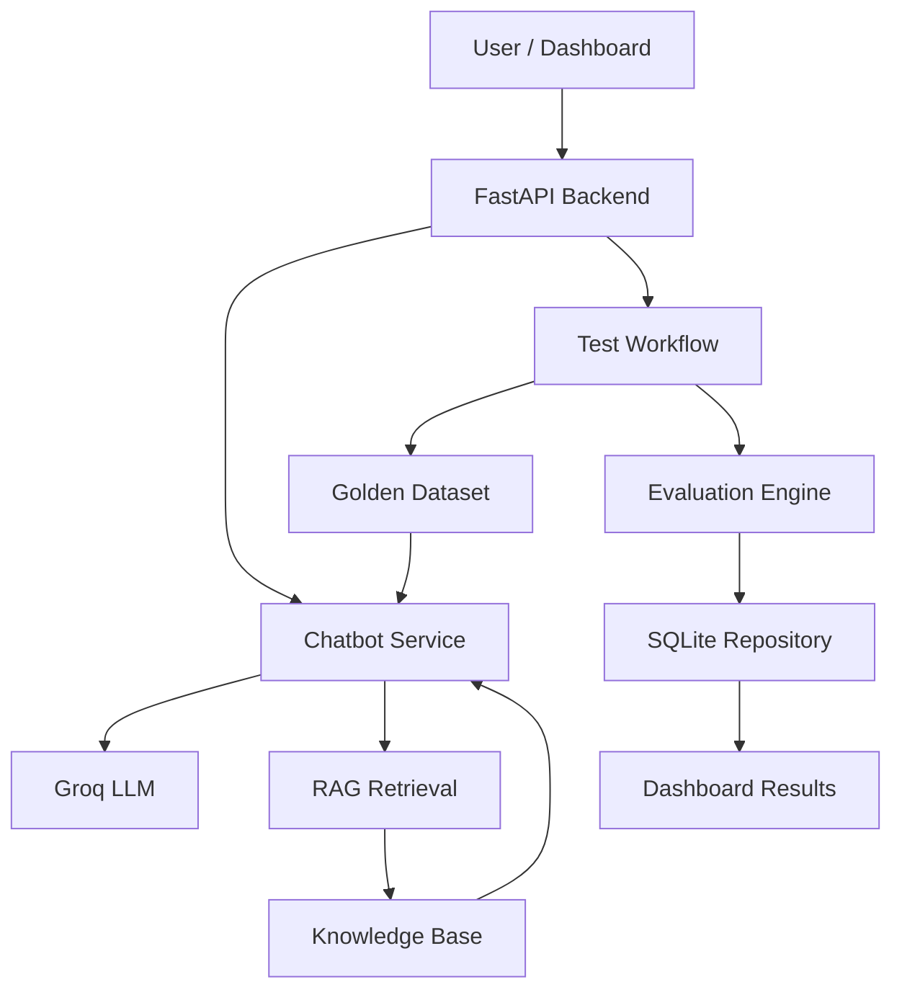

# 🤖 AI-TestMate — AI-Powered Quality Engineering Platform

<p align="center">
  <strong>Test smarter. Evaluate AI. Catch regressions.</strong>
</p>

<p align="center">
  <a href="https://ai-test-mate-d4is.vercel.app/">
    
  </a>
  <a href="https://github.com/Adityapushp/AI-TestMate">
    
  </a>
</p>

<p align="center">
  
  
  
  
  
</p>

---

## 🌐 Live Application

**Try AI-TestMate here:**

### 👉 [https://ai-test-mate-d4is.vercel.app/](https://ai-test-mate-d4is.vercel.app/)

Explore the chatbot, execute golden test cases, and inspect AI response quality through the dashboard.

---

## 📌 Overview

AI-TestMate is an AI-powered quality engineering platform designed to evaluate chatbot behaviour, test response quality, and identify potential regressions.

It combines a Retrieval-Augmented Generation (RAG) chatbot with automated testing and evaluation workflows.

Instead of relying only on whether an API returns a successful response, AI-TestMate focuses on a more important question:

**Does the AI actually provide a relevant, accurate, and context-grounded answer?**

The platform provides a simple dashboard to interact with the chatbot, execute predefined test cases, and inspect evaluation results.

## ✨ Key Features

### 💬 AI-Powered Support Chatbot
- Integrates with the Groq API for LLM-powered response generation.
- Answers smart-home support questions using retrieved knowledge.
- Uses contextual information to generate more relevant responses.

### 🧠 Retrieval-Augmented Generation (RAG)
- Retrieves relevant information from a knowledge base.
- Provides supporting context to the language model before answer generation.
- Helps reduce unsupported or irrelevant responses.

### 🧪 Automated Quality Testing
- Executes predefined golden test cases against the chatbot.
- Evaluates chatbot responses using configured evaluation criteria.
- Identifies failed cases and potential response-quality regressions.

### 📊 Quality Dashboard
- Provides a simple interface to interact with the chatbot.
- Runs the golden test suite through a single action.
- Displays test execution results and quality metrics.

### 🔍 Test Result Tracking
- Uses SQLite to store test execution results.
- Maintains run-level information and individual case results.

### ⚙️ Development & CI
- Uses Pytest for automated testing.
- Supports GitHub Actions for continuous integration.
- Provides FastAPI endpoints and API documentation.

---

## 🏗️ Architecture



### Quality Testing Workflow

1. Load test cases from the golden dataset.
2. Send each test question to the chatbot.
3. Retrieve the chatbot's generated response.
4. Evaluate the response against the configured quality criteria.
5. Record pass/fail results and evaluation details.
6. Display the execution results in the dashboard.

---

## 🛠️ Technology Stack

| Category | Technologies |
|---|---|
| Language | Python |
| Backend | FastAPI |
| LLM Integration | Groq API |
| AI Architecture | Retrieval-Augmented Generation (RAG) |
| Testing | Pytest |
| Evaluation | Custom evaluation logic |
| Database | SQLite |
| Frontend | HTML, CSS, JavaScript |
| CI/CD | GitHub Actions |
| Deployment | Vercel |

---

## 🚀 Getting Started

Follow these steps to run AI-TestMate locally.

### 1. Clone the repository

```bash
git clone https://github.com/Adityapushp/AI-TestMate.git
cd AI-TestMate
```

### 2. Create a virtual environment

**Windows:**

```powershell
python -m venv .venv
.venv\Scripts\Activate.ps1
```

**Linux / macOS:**

```bash
python3 -m venv .venv
source .venv/bin/activate
```

### 3. Install dependencies

```bash
pip install -r requirements.txt
```

### 4. Configure environment variables

Create a `.env` file in the project root:

```env
AI_TESTMATE_CHAT_PROVIDER=groq
GROQ_API_KEY=your_groq_api_key
AI_TESTMATE_CHAT_MODEL=openai/gpt-oss-20b
```

Get your API key from [Groq Console](https://console.groq.com/).

**Note:** Never commit your `.env` file or expose your API key in frontend code.

### 5. Start the application

```bash
uvicorn app.main:app --reload
```

Open the application:

- Dashboard: http://127.0.0.1:8000
- API documentation: http://127.0.0.1:8000/docs

---

## 🧪 Running Tests

Execute the automated test suite:

```bash
pytest -q
```

The platform also provides a dashboard-based golden test execution workflow.

Use the **Run All Tests** action to execute the configured chatbot evaluation dataset.

---

## 🔐 Environment Configuration

| Variable | Description |
|---|---|
| `AI_TESTMATE_CHAT_PROVIDER` | Selects the chatbot provider (`groq` or demo mode) |
| `GROQ_API_KEY` | API key used for Groq integration |
| `AI_TESTMATE_CHAT_MODEL` | Groq model identifier |

Keep API credentials in environment variables. For deployment, configure them through your hosting provider's environment-variable settings.

---

## 🎯 Project Goals

AI-TestMate was built to explore practical challenges in AI quality engineering:

- How can LLM-generated responses be evaluated systematically?
- How can golden datasets help detect regressions?
- How can retrieval improve the relevance of AI-generated answers?
- How can automated workflows make chatbot quality testing repeatable?
- How can evaluation results be made easier to inspect and understand?

The project demonstrates an approach to combining AI application development with software quality engineering.

---

## 🔮 Future Improvements

- Integrate dedicated LLM evaluation frameworks such as DeepEval and Ragas.
- Add hallucination and faithfulness evaluation metrics.
- Expand golden datasets with more edge cases and adversarial prompts.
- Introduce browser-based testing with Playwright.
- Add Android automation using Appium.
- Introduce persistent cloud database storage and detailed evaluation analytics.

---

## 👨‍💻 Author

**Aditya Pushp**

Computer Science Graduate | Software Developer | AI Enthusiast

- GitHub: [Adityapushp](https://github.com/Adityapushp)
- LinkedIn: [Aditya Pushp](https://www.linkedin.com/in/aditya-pushp-702244279)

---

<p align="center">
  <strong>Built with curiosity, experimentation, and a focus on making AI more reliable. 🚀</strong>
</p>
